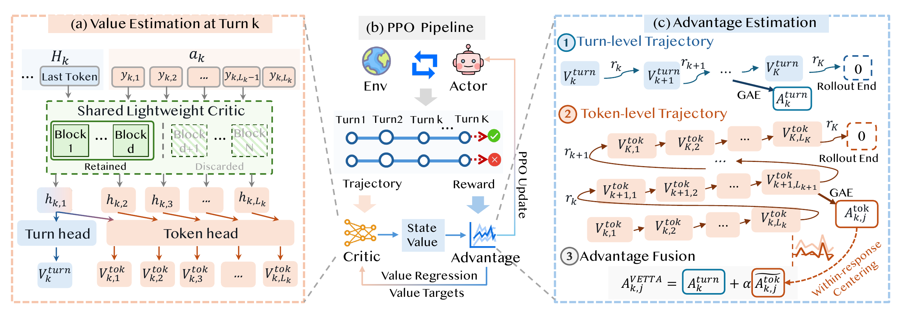
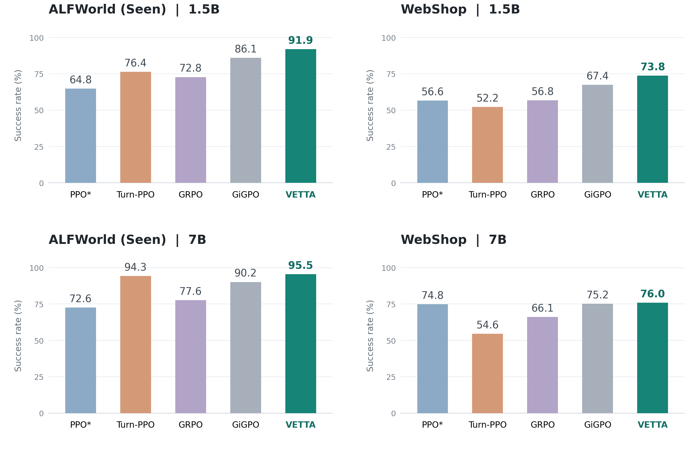

# VETTA: Coordinating Turn- and Token-Level Credit Assignment for Multi-Turn LLM Agents

[**Paper**](docs/paper.pdf) · [**Quick Start**](docs/QUICKSTART.md) · [**中文指南**](docs/OFFICIAL_QUICKSTART_ZH.md)

## Overview

**VETTA learns credit at two complementary scales for multi-turn LLM agents:**
which responses contribute to task progress, and how credit varies between
the tokens generated within each response. A lightweight shared critic learns
both value estimates; their advantages are coordinated in a single PPO update.

Turn advantages provide the response-level signal; a within-response-centered
token residual refines credit across generation decisions. Two value heads
share a shallow critic backbone while the actor remains full-depth.



## Results

VETTA combines turn- and token-level credit and achieves the highest reported
mean success rate among these five methods across both benchmarks and model sizes.



Values are the means reported in [Table 1 of the paper](docs/paper.pdf).
ALFWorld uses overall seen-task success; WebShop uses strict task completion.
PPO* computes token-level GAE across turns within each trajectory, skipping
observation tokens, and uses the token-level PPO ratio.

## Quick Start

Start with **ALFWorld + Qwen2.5-1.5B-Instruct**.
The launch recipe below uses Linux, Python 3.10, and 8x80GB NVIDIA GPUs.

```bash
git clone https://github.com/Jiaju-Chen/VETTA-official.git
cd VETTA-official
```

[Install the runtime](docs/QUICKSTART.md#1-install), then follow the three steps below.

### 1. Download and Prepare

```bash
export VETTA_WORK="$HOME/vetta-work"
export MODEL="$VETTA_WORK/models/Qwen2.5-1.5B-Instruct"
export ALFWORLD_DATA="$VETTA_WORK/alfworld"
export DATA="$VETTA_WORK/manifests/alfworld"
mkdir -p "$VETTA_WORK"

hf download Qwen/Qwen2.5-1.5B-Instruct --local-dir "$MODEL"
alfworld-download -f
python scripts/prepare_data.py alfworld --output "$DATA"
CUDA_VISIBLE_DEVICES='' python scripts/check_envs.py alfworld
```

The environment check reports `"passed": true` and 140 valid seen tasks.
With existing assets, set the paths above to their locations and skip downloads.

### 2. Check the Training Pipeline

```bash
export CUDA_VISIBLE_DEVICES=0,1,2,3,4,5,6,7
export SMOKE_ID="$(date +%Y%m%d-%H%M%S)"
python scripts/run.py alfworld smoke \
  --model "$MODEL" --data "$DATA" \
  --output "$VETTA_WORK/runs/alfworld-smoke-$SMOKE_ID" \
  --checkpoints "$VETTA_WORK/checkpoints/alfworld-smoke-$SMOKE_ID"
```

The smoke test runs two updates with a short horizon. A successful run exits
with code 0 and saves checkpoint step2. It checks rollout, actor/critic
updates, and saving; use the next command for benchmark training.

### 3. Train VETTA

```bash
export RUN_ID="$(date +%Y%m%d-%H%M%S)"
export RUN="$VETTA_WORK/runs/alfworld-vetta-$RUN_ID"
export CKPTS="$VETTA_WORK/checkpoints/alfworld-vetta-$RUN_ID"
python scripts/run.py alfworld train \
  --model "$MODEL" --data "$DATA" --output "$RUN" --checkpoints "$CKPTS" \
  --actor-micro 8 --critic-micro 8
```

Training starts from pretrained weights for 150 updates, with validation and
latest-only saving every 5 updates. Read progress from `$RUN/console.log`
and validation results from `$RUN/validation.jsonl`.

**Next:** [WebShop](docs/QUICKSTART.md#4-webshop) ·
[Baselines](docs/QUICKSTART.md#5-baselines) ·
[Resume training](docs/QUICKSTART.md#6-resume) ·
[Three-seed evaluation](docs/QUICKSTART.md#7-evaluate)

## Training Profiles

The ready-to-run profiles use Qwen2.5-1.5B-Instruct and a shared 2-block,
dual-head critic. All retained critic components are trainable.

| Setting | ALFWorld | WebShop |
|:---|:---:|:---:|
| Residual scale alpha | 1 | 3 |
| Token gamma / lambda | 1 / 1 | 1 / 1 |
| Turn gamma / lambda | 0.95 / 0.95 | 0.95 / 0.95 |
| Tasks x rollouts per update | 128 x 1 | 128 x 1 |
| PPO mini-batch | 256 | 64 |
| Maximum environment turns | 50 | 15 |
| Prompt / response tokens | 4096 / 512 | 4096 / 512 |
| Evaluation tasks | Seen140 | Fixed500 |
| Decoding seeds | 123, 456, 789 | 123, 456, 789 |

Final evaluation uses the latest step150 checkpoint with temperature0.4,
environment seed0, and the same task manifest across decoding seeds.

## Baselines

Use the same launcher with `--method` and separate run/checkpoint directories:

| Method | Flag | Credit and policy update |
|:---|:---|:---|
| VETTA | `vetta` | Shallow shared dual-head critic; coordinated credit; token ratio |
| PPO* | `ppo_star` | Full-depth scalar critic; cross-observation token GAE; token ratio |
| Turn-PPO | `turn_ppo` | Full-depth scalar critic; turn GAE; whole-response ratio |
| GiGPO | `gigpo` | Critic-free; 16 tasks x 8 rollouts |

[Baseline launch commands](docs/QUICKSTART.md#5-baselines)

## Acknowledgments

The implementation builds on veRL and GiGPO/verl-agent for multi-turn rollout,
environment interaction, Ray, FSDP, and vLLM. VETTA adds the lightweight
dual-head critic and coordinated advantage computation.

The upstream Apache-2.0 license and attribution notices are retained.
See [LICENSE](LICENSE) and [Notice.txt](Notice.txt).
Model weights and benchmark assets follow their respective licenses.
