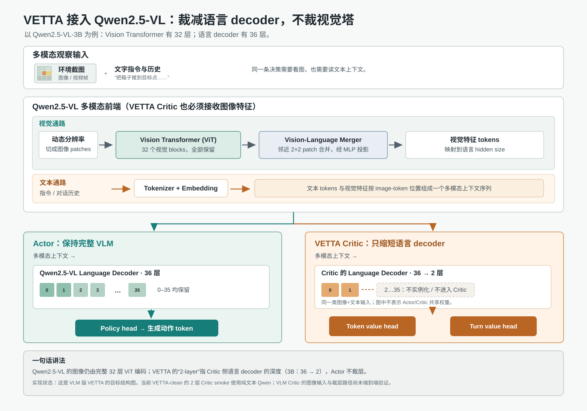

# Qwen2.5-VL 中 VETTA 的裁层位置

## 结论

这里的“2-layer Critic”指 **语言模型 decoder 的 Transformer blocks**，不是视觉 ViT 的层数。以 Qwen2.5-VL-3B 为例，官方配置是视觉 ViT 32 层、语言 decoder 36 层；目标结构应让 Actor 保持 36 层，而把 Critic 的语言 decoder 截到 2 层。视觉编码器与 Vision-Language Merger 保留，图像特征仍需进入 Critic，否则 Sokoban 的 value 预测就看不到棋盘。

Qwen 官方技术报告已有通用 VLM 结构图（Figure 1），展示视觉编码器、Merger 到语言 decoder 的路径；本目录的图是在该结构上叠加 VETTA 的 Critic 裁层位置，不是复用或修改官方原图。[Qwen2.5-VL 技术报告](https://arxiv.org/abs/2502.13923)；[Qwen 官方介绍](https://qwenlm.github.io/blog/qwen2.5-vl/)。

## 代码状态边界

这个图是 VLM 版 VETTA 的**目标设计**，不是当前干净仓库已通过验证的事实。当前 [CriticWorker](../verl/workers/fsdp_workers.py) 用 `AutoModelForTokenClassification` 加载 Critic；仓库中的 [截断 Critic smoke](../tests/workers/critic/smoke_truncated_qwen_critic.py) 使用的是纯文本 `Qwen2.5-1.5B-Instruct`，并断言它只有两个 decoder blocks。Qwen-VL 的 Actor 图像路径在 [qwen2_vl.py](../verl/models/transformers/qwen2_vl.py) 中有处理，但没有对应的 VLM Critic 图像输入 + 双 value head + 截断 decoder 的端到端 smoke。

另外，Qwen2.5-VL 是复合配置，语言层数位于 `text_config.num_hidden_layers`，视觉层数位于 `vision_config.depth`。因此 VLM 适配时必须显式改 Critic 的 `text_config.num_hidden_layers=2`，不能只把纯文本模型的 `num_hidden_layers=2` 覆盖方式照搬过去；并且需要检查实例化后的 `critic.model.language_model.layers` 长度确实为 2、视觉输入能 forward、两个 value head 输出维度正确，再把图称为已实现结构。

## 主要来源

- Qwen2.5-VL 技术报告：Figure 1 描述 ViT + Vision-Language Merger + Qwen2.5 LM Decoder；表 1 给出 3B 的 ViT 32 层、LLM 36 层。<https://arxiv.org/abs/2502.13923>
- 官方 Qwen2.5-VL-3B 配置：根配置中的 `num_hidden_layers=36` 与 `vision_config.depth=32`。<https://huggingface.co/Qwen/Qwen2.5-VL-3B-Instruct/blob/main/config.json>
- Transformers 的 Qwen2.5-VL 配置定义将 `text_config` 和 `vision_config` 作为独立子配置。<https://github.com/huggingface/transformers/blob/main/src/transformers/models/qwen2_5_vl/configuration_qwen2_5_vl.py>
- Transformers 的 Qwen2.5-VL 实现分别建立 `visual` encoder 和 `language_model`，并把 Merger 后的视觉特征填入图像 token 对应的 embedding 位置。<https://github.com/huggingface/transformers/blob/main/src/transformers/models/qwen2_5_vl/modeling_qwen2_5_vl.py>
